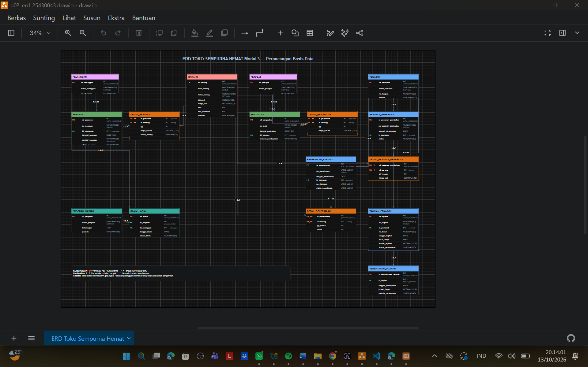

# LAPORAN PRAKTIKUM BASIS DATA
## MODUL 3 — PERANCANGAN ERD KONSEPTUAL

**Nama:** HILMAN AHMAD ROSYAD  
**NIM:** 25430043  
**Kelas:** B  
**Mata Kuliah:** Praktikum Basis Data  
**Tema Proyek:** Toko Daring  
**Nama Usaha:** Toko Sempurna Hemat  
**Database:** `tokodaring_043`

---

## 1. Pendahuluan

Toko Sempurna Hemat merupakan usaha yang menjual berbagai kebutuhan sehari-hari, seperti makanan ringan, minuman, sembako, dan perlengkapan rumah tangga. Dalam kegiatan operasionalnya, toko melayani pembelian secara langsung maupun pemesanan melalui WhatsApp yang kemudian diambil di toko.

Kegiatan tersebut membutuhkan pencatatan data pelanggan, barang, pesanan, penjualan, pemasok, pembelian barang, penerimaan barang, dan tagihan pemasok. Toko juga memerlukan pencatatan program hadiah agar informasi program dan klaim pelanggan dapat ditelusuri.

Pada Modul 3 ini, kebutuhan data yang telah disusun pada Modul 2 dikembangkan menjadi Entity Relationship Diagram (ERD) konseptual. Diagram digunakan untuk menunjukkan entitas, atribut, kunci, hubungan ant entitas, dan kardinalitasnya sebelum rancangan dilanjutkan ke tahap struktur tabel basis data.

## 2. Tujuan Praktikum

1. Mengidentifikasi entitas dan atribut berdasarkan dokumen kebutuhan data P02.
2. Menentukan primary key dan foreign key untuk membantu menjaga keterkaitan data.
3. Menggambarkan hubungan ant entitas dengan notasi Crow's Foot.
4. Memetakan kebutuhan informasi toko ke dalam rancangan ERD.
5. Memeriksa konsistensi rancangan dengan aturan bisnis Toko Sempurna Hemat.

## 3. Dasar Teori

### 3.1 Entity Relationship Diagram

Entity Relationship Diagram atau ERD merupakan diagram yang digunakan untuk menggambarkan struktur data dan hubungan ant entitas dalam suatu sistem. ERD membantu menunjukkan data yang perlu disimpan serta keterkaitan antara satu bagian data dengan bagian lainnya.

### 3.2 Entitas dan atribut

Entitas merupakan objek atau konsep yang datanya dikelola dalam sistem. Contohnya adalah pelanggan, barang, pesanan, dan pemasok. Atribut merupakan informasi yang menjelaskan suatu entitas, seperti nama pelanggan, kode barang, tanggal pesanan, dan status pembayaran.

### 3.3 Primary key dan foreign key

Primary key (PK) merupakan atribut yang digunakan untuk membedakan setiap data dalam suatu entitas. Foreign key (FK) merupakan atribut yang menghubungkan suatu entitas dengan entitas lain. Pada entitas detail, kunci gabungan dapat digunakan ketika identitas sebuah baris ditentukan oleh kombinasi beberapa atribut.

### 3.4 Kardinalitas

Kardinalitas menjelaskan jumlah data pada suatu entitas yang dapat berhubungan dengan entitas lain. Notasi Crow's Foot digunakan untuk menggambarkan hubungan satu, banyak, serta partisipasi opsional atau wajib.

### 3.5 Entitas detail

Entitas detail digunakan untuk mencatat rincian dari suatu transaksi. Contohnya, `detail_pesanan` menghubungkan pesanan dengan barang yang dipesan. Pola ini memungkinkan satu pesanan memuat beberapa barang dan satu barang muncul dalam banyak transaksi.

## 4. Alat dan Bahan

1. Dokumen kebutuhan data P02 proyek Toko Sempurna Hemat.
2. GitHub untuk menyimpan dokumen dan berkas praktikum.
3. diagrams.net (Draw.io) untuk membuat dan menyunting diagram ERD.
4. Notasi Crow's Foot untuk menggambarkan kardinalitas.
5. Dokumen kamus data dan kebutuhan informasi sebagai bahan validasi.

## 5. Langkah Kerja

1. Meninjau kembali dokumen `p02_kebutuhan_data_25430043.md`.
2. Mengidentifikasi entitas dan atribut yang dibutuhkan oleh proses bisnis toko.
3. Menentukan kandidat primary key dan foreign key.
4. Menentukan hubungan dan kardinalitas ant entitas.
5. Membuat diagram ERD konseptual menggunakan notasi Crow's Foot.
6. Memeriksa diagram terhadap kebutuhan informasi dan aturan bisnis pada P02.
7. Menyimpan diagram dalam format PNG dan Draw.io agar dapat dilihat dan disunting kembali.

## 6. Hasil Perancangan ERD

ERD proyek Toko Sempurna Hemat dirancang untuk menggambarkan pengelolaan pelanggan, barang, pemesanan, penjualan, pembelian barang dari pemasok, penerimaan barang, tagihan pemasok, pembayaran tagihan, dan program hadiah pelanggan.

**Diagram ERD:**

Berkas gambar diagram direncanakan disimpan dengan nama `p03_erd_25430043.png`, sedangkan sumber yang dapat disunting disimpan dengan nama `p03_erd_25430043.drawio`.

### 6.1 Daftar entitas

| No. | Entitas | Fungsi |
|---:|---|---|
| 1 | `pelanggan` | Menyimpan identitas dan kontak pelanggan. |
| 2 | `petugas` | Menyimpan data petugas yang melayani transaksi dan memeriksa penerimaan. |
| 3 | `barang` | Menyimpan kode, nama, kategori, harga jual, dan informasi stok barang. |
| 4 | `pesanan` | Mencatat pesanan pelanggan dan status pengambilan. |
| 5 | `detail_pesanan` | Mencatat barang dan rincian dalam setiap pesanan. |
| 6 | `penjualan` | Mencatat transaksi penjualan yang dilayani petugas. |
| 7 | `detail_penjualan` | Mencatat barang, jumlah, dan harga satuan pada transaksi penjualan. |
| 8 | `pemasok` | Menyimpan informasi pemasok barang. |
| 9 | `pesanan_pembelian` | Mencatat pemesanan barang kepada pemasok. |
| 10 | `detail_pesanan_pembelian` | Mencatat rincian barang dan jumlah yang dipesan dari pemasok. |
| 11 | `penerimaan_barang` | Mencatat kegiatan penerimaan barang dari pemasok. |
| 12 | `detail_penerimaan` | Mencatat jumlah barang yang diterima serta selisih penerimaan. |
| 13 | `tagihan_pemasok` | Menyimpan informasi faktur, jumlah tagihan, jatuh tempo, dan status pembayaran. |
| 14 | `pembayaran_tagihan` | Mencatat tanggal dan jumlah pembayaran tagihan pemasok. |
| 15 | `program_hadiah` | Menyimpan informasi program hadiah dan periodenya. |
| 16 | `klaim_hadiah` | Mencatat klaim program hadiah oleh pelanggan. |

Entitas `pembayaran_tagihan` digunakan untuk menampung atribut pembayaran yang terdapat dalam dokumen kebutuhan data P02, yaitu identitas pembayaran, tanggal pembayaran, dan jumlah pembayaran.

### 6.2 Tabel hubungan dan kardinalitas

| No. | Entitas yang berhubungan | Hubungan | Kardinalitas |
|---:|---|---|---|
| 1 | `pelanggan` — `pesanan` | Mempunyai | Satu pelanggan dapat memiliki nol atau banyak pesanan. |
| 2 | `pesanan` — `detail_pesanan` | Berisi | Satu pesanan memiliki satu atau banyak baris detail. |
| 3 | `barang` — `detail_pesanan` | Tercantum pada | Satu barang dapat muncul pada nol atau banyak baris detail pesanan. |
| 4 | `pesanan` — `penjualan` | Dapat terkait | Hubungan opsional yang masih perlu dikonfirmasi berdasarkan aturan bisnis. |
| 5 | `petugas` — `penjualan` | Melayani | Satu petugas dapat melayani nol atau banyak transaksi penjualan. |
| 6 | `penjualan` — `detail_penjualan` | Berisi | Satu penjualan memiliki satu atau banyak baris detail. |
| 7 | `barang` — `detail_penjualan` | Tercantum pada | Satu barang dapat tercantum pada nol atau banyak detail penjualan. |
| 8 | `pemasok` — `pesanan_pembelian` | Terkait dengan | Satu pemasok dapat memiliki nol atau banyak pesanan pembelian. |
| 9 | `pesanan_pembelian` — `detail_pesanan_pembelian` | Berisi | Satu pesanan pembelian memiliki satu atau banyak baris detail. |
| 10 | `barang` — `detail_pesanan_pembelian` | Tercantum pada | Satu barang dapat muncul pada nol atau banyak detail pesanan pembelian. |
| 11 | `pemasok` — `penerimaan_barang` | Memasok | Satu pemasok dapat terkait dengan nol atau banyak penerimaan barang. |
| 12 | `petugas` — `penerimaan_barang` | Memeriksa | Satu petugas dapat memeriksa nol atau banyak penerimaan barang. |
| 13 | `pesanan_pembelian` — `penerimaan_barang` | Direalisasi melalui | Satu pesanan pembelian dapat memiliki nol atau banyak catatan penerimaan. |
| 14 | `penerimaan_barang` — `detail_penerimaan` | Mempunyai | Satu penerimaan memiliki satu atau banyak baris detail. |
| 15 | `barang` — `detail_penerimaan` | Tercantum pada | Satu barang dapat muncul pada nol atau banyak detail penerimaan. |
| 16 | `pemasok` — `tagihan_pemasok` | Mempunyai | Satu pemasok dapat mempunyai nol atau banyak tagihan. |
| 17 | `tagihan_pemasok` — `pembayaran_tagihan` | Mempunyai | Satu tagihan dapat memiliki nol atau banyak catatan pembayaran. |
| 18 | `program_hadiah` — `klaim_hadiah` | Memiliki | Satu program dapat memiliki nol atau banyak klaim hadiah. |
| 19 | `pelanggan` — `klaim_hadiah` | Mengajukan | Satu pelanggan dapat mengajukan nol atau banyak klaim hadiah. |

Kardinalitas pada tabel ini perlu dibaca bersama simbol pada diagram. Hubungan yang masih ditandai opsional atau perlu dikonfirmasi tidak dianggap sebagai aturan bisnis yang sudah final.

### 6.3 Entitas penghubung

Entitas detail digunakan untuk menghubungkan transaksi dengan barang. Contohnya adalah `detail_pesanan`, `detail_penjualan`, `detail_pesanan_pembelian`, dan `detail_penerimaan`.

Pada `detail_penerimaan`, kombinasi `id_penerimaan` dan `id_barang` dirancang sebagai kunci gabungan sekaligus foreign key. Atribut `qty_terima`, `selisih_penerimaan`, dan `catatan_selisih` digunakan untuk mencatat hasil penerimaan barang.

## 7. Penelusuran Kebutuhan Informasi (KI)

| Kode KI | Kebutuhan informasi | Entitas dan atribut pendukung |
|---|---|---|
| KI-01 | Mengetahui pesanan yang masih diproses atau siap diambil. | `pesanan`: `status_pesanan`, `waktu_siap_diambil`, `waktu_diambil`. |
| KI-02 | Menelusuri perubahan, penambahan, dan pembatalan barang dalam pesanan. | `detail_pesanan`: `status_barang_pesanan`, `catatan_perubahan`, `qty_pesanan`. |
| KI-03 | Melihat penjualan dan barang terlaris berdasarkan periode. | `penjualan`, `detail_penjualan`, dan `barang`, termasuk tanggal, jumlah, dan harga satuan. |
| KI-04 | Mengetahui barang yang stoknya rendah. | `barang`: `stok` dan `stok_minimum`. |
| KI-05 | Membandingkan jumlah barang yang dipesan dan diterima dari pemasok. | `detail_pesanan_pembelian` dan `detail_penerimaan`, termasuk atribut jumlah serta selisih penerimaan. |
| KI-06 | Mengetahui tagihan pemasok yang belum dibayar atau mendekati jatuh tempo. | `tagihan_pemasok` dan `pembayaran_tagihan`, termasuk `jatuh_tempo`, `status_pembayaran`, dan riwayat pembayaran. |
| KI-07 | Mencari barang berdasarkan nama, kode, atau barcode. | `barang`: `nama_barang`, `kode_barang`, dan `barcode`. |
| KI-08 | Mengetahui program hadiah dan status klaim pelanggan. | `program_hadiah` dan `klaim_hadiah`, yang terhubung dengan `pelanggan`. |

## 8. Analisis dan Pembahasan

### 8.1 Hubungan transaksi dan barang

Transaksi dapat memuat lebih dari satu jenis barang. Karena itu, entitas detail diperlukan untuk menyimpan jumlah dan harga satuan setiap barang tanpa menumpuk beberapa barang dalam satu atribut transaksi.

### 8.2 Riwayat harga transaksi

Harga jual barang saat ini dapat berubah. Oleh sebab itu, harga satuan yang tercatat pada detail penjualan digunakan untuk mempertahankan informasi harga pada transaksi yang telah terjadi. Perubahan harga barang tidak seharusnya mengubah catatan transaksi lama.

### 8.3 Penerimaan barang

Jumlah barang yang diterima perlu dicatat secara terpisah dari jumlah yang dipesan. Dengan demikian, toko dapat mengetahui apakah jumlah penerimaan sama, lebih sedikit, atau lebih banyak daripada jumlah pesanan. Catatan selisih juga membantu proses pemeriksaan dengan pemasok.

### 8.4 Tagihan pemasok

Informasi tagihan memuat nomor faktur, tanggal tagihan, jatuh tempo, jumlah tagihan, dan status pembayaran. Pencatatan pembayaran terpisah memungkinkan lebih dari satu pembayaran dicatat untuk sebuah tagihan jika aturan bisnis mendukung pembayaran bertahap.

### 8.5 Hal yang masih perlu dikonfirmasi

1. Hubungan pesanan pelanggan dengan transaksi penjualan perlu dipastikan berdasarkan prosedur operasional toko.
2. Aturan hubungan pesanan pembelian dengan penerimaan perlu memastikan apakah satu pesanan dapat diterima dalam beberapa tahap.
3. Penanganan perubahan pesanan dan riwayat perubahan perlu dipastikan agar perubahan yang terjadi berulang kali dapat ditelusuri dengan baik.
4. Aturan pembayaran tagihan perlu dipastikan agar status pembayaran mencerminkan jumlah pembayaran yang benar.

## 9. Tinjauan dan Masukan Teman

Masukan teman perlu berasal dari peninjauan nyata terhadap diagram. Catat hasilnya pada tabel berikut setelah memperoleh masukan.

| No. | Nama teman | Masukan yang diberikan | Keputusan dan alasan |
|---:|---|---|---|
| 1 | [Isi nama teman pertama] | [Isi masukan asli] | [Tuliskan diterima atau ditolak beserta alasan] |
| 2 | [Isi nama teman kedua] | [Isi masukan asli] | [Tuliskan diterima atau ditolak beserta alasan] |

Bagian ini harus dilengkapi berdasarkan hasil tinjauan teman yang benar-benar dilakukan, bukan dengan masukan yang dibuat-buat.

## 10. Kesimpulan

Perancangan ERD konseptual Toko Sempurna Hemat membantu menggambarkan kebutuhan data utama dalam kegiatan penjualan, pemesanan, pembelian, penerimaan barang, pengelolaan tagihan pemasok, serta program hadiah. Hubungan ant entitas dirancang menggunakan primary key, foreign key, dan kardinalitas agar keterkaitan data dapat dipahami sebelum implementasi basis data.

Hasil rancangan masih memerlukan validasi terhadap aturan bisnis yang belum pasti, terutama hubungan pesanan dengan penjualan serta ketentuan penerimaan dan pembayaran. Setelah validasi dan tinjauan teman dilakukan, ERD dapat digunakan sebagai dasar untuk tahapan perancangan berikutnya.

## 11. Pernyataan Penggunaan Bantuan AI

Bantuan AI digunakan untuk mendukung penyusunan draf penjelasan dan pemeriksaan konsistensi rancangan. Hasilnya tetap perlu diperiksa dan disesuaikan dengan dokumen kebutuhan data P02, aturan bisnis toko, dan masukan peninjau.

## 12. Daftar Berkas dan Bukti

Berkas yang perlu tersedia dalam repositori:

- [ ] `p03_erd_25430043.drawio` — sumber diagram yang dapat disunting.
- [ ] `laporan/img/p03_erd_25430043.png` — gambar hasil ERD.
- [ ] `laporan/p03_laporan_25430043.md` — laporan praktikum Modul 3.
- [ ] Tabel relasi dan kardinalitas telah diperiksa.
- [ ] Tabel penelusuran KI telah diperiksa.
- [ ] Dua masukan teman dan keputusan tindak lanjut telah dicatat.
- [ ] Bukti pengerjaan GitHub dan hasil diagram telah disimpan jika diwajibkan oleh petunjuk praktikum.

**Catatan:** Nama dan lokasi berkas pada daftar ini harus disesuaikan dengan lokasi berkas yang benar-benar diunggah ke repositori.
