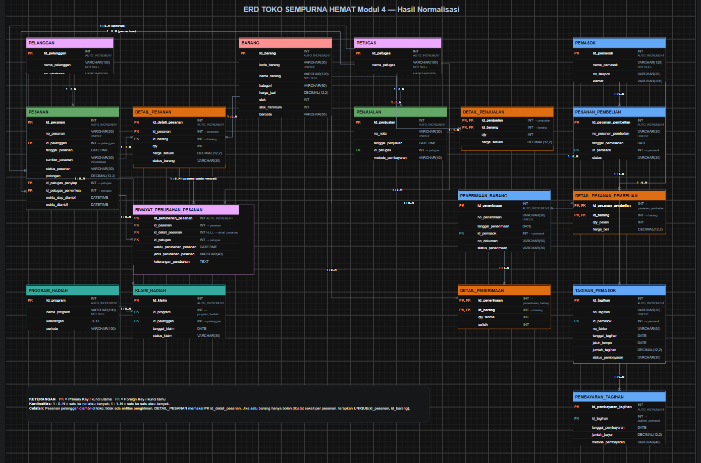

## F. Tugas Mandiri: Milestone Proyek 4

### F.1 Menentukan Dokumen Sumber dan Bentuk UNF

Dokumen sumber yang digunakan adalah Formulir Pesanan dan Pengambilan Pelanggan yang sudah dibahas pada Modul 2 di `p02_kebutuhan_data_25430043.md`.

Formulir tersebut berisi nomor pesanan, tanggal pesanan, nama pelanggan, nomor WhatsApp, sumber pesanan, daftar barang, jumlah, harga satuan, status barang, subtotal, potongan, total, status pesanan, catatan perubahan, serta informasi persiapan dan pengambilan pesanan.

Satu pesanan dapat berisi beberapa jenis barang. Karena itu, data awalnya masih dapat memiliki kelompok rincian barang yang berulang.

Bentuk UNF dituliskan sebagai berikut:

```text
PESANAN_UNF (
    no_pesanan,
    tanggal_pesanan,
    nama_pelanggan,
    no_whatsapp,
    sumber_pesanan,
    {
        kode_barang,
        nama_barang,
        qty_pesanan,
        harga_satuan_pesanan,
        status_barang_pesanan
    },
    subtotal,
    potongan,
    total,
    status_pesanan,
    catatan_perubahan,
    disiapkan_oleh,
    diperiksa_oleh,
    waktu_siap_diambil,
    waktu_diambil
)
```

Tanda `{ ... }` menunjukkan kelompok rincian barang yang dapat muncul lebih dari satu kali dalam satu pesanan. Bentuk ini akan menjadi dasar untuk tahap normalisasi berikutnya.

### F.2 Menentukan Ketergantungan Fungsional (FD)

Ketergantungan fungsional digunakan untuk menentukan atribut mana yang nilainya bergantung pada atribut lain. Penentuannya didasarkan pada aturan bisnis P02 dan rancangan ERD P03.

| Kode | Ketergantungan fungsional | Dasar |
|---|---|---|
| FD-01 | `no_pesanan` → `tanggal_pesanan`, `nama_pelanggan`, `no_whatsapp`, `sumber_pesanan`, `status_pesanan` | AB-05 menetapkan bahwa nomor pesanan harus unik; AB-07 mengatur status pesanan. |
| FD-02 | `id_pelanggan` → `nama_pelanggan`, `no_whatsapp` | Mengikuti entitas Pelanggan dan atributnya pada P02. |
| FD-03 | `kode_barang` → `nama_barang` | AB-01 menetapkan bahwa setiap barang harus mempunyai kode yang berbeda. |
| FD-04 | (`no_pesanan`, `kode_barang`) → `qty_pesanan`, `harga_satuan_pesanan`, `status_barang_pesanan` | Asumsi sementara bahwa satu jenis barang hanya memiliki satu baris dalam satu pesanan. Asumsi ini harus diperiksa terhadap kebutuhan perubahan pesanan. |

FD-04 masih perlu diperiksa karena kamus data P02 mencantumkan `id_detail_pesanan`, sedangkan ERD P03 memakai kunci gabungan `id_pesanan` dan `id_barang` pada `detail_pesanan`. Perbedaan tersebut akan dicatat dalam evaluasi hasil normalisasi agar kunci akhir tidak dipilih tanpa alasan.

Catatan: Atribut `id_pelanggan` berasal dari model entitas Pelanggan pada
Modul 2 dan ERD Modul 3. Atribut ini tidak tercetak langsung
pada formulir sumber, sehingga penggunaannya perlu diselaraskan
ketika struktur relasi hasil normalisasi dipetakan ke ERD.
### F.3 Tahapan Normalisasi

#### F.3.1 Bentuk Normal Pertama (1NF)

Pada tahap 1NF, kelompok barang yang berulang dipisahkan sehingga setiap baris mencatat satu rincian barang dalam satu pesanan. Informasi umum pesanan masih ikut tercatat pada bentuk awal ini, sehingga beberapa data masih berulang dan akan dipisahkan pada tahap berikutnya.

Contoh struktur relasi 1NF:

| Nama Relasi | Atribut | Kunci sementara |
|---|---|---|
| `PESANAN_1NF` | `no_pesanan`, `kode_barang`, `tanggal_pesanan`, `nama_pelanggan`, `no_whatsapp`, `sumber_pesanan`, `nama_barang`, `qty_pesanan`, `harga_satuan_pesanan`, `status_barang_pesanan`, `subtotal`, `potongan`, `total`, `status_pesanan`, `catatan_perubahan`, `disiapkan_oleh`, `diperiksa_oleh`, `waktu_siap_diambil`, `waktu_diambil` | (`no_pesanan`, `kode_barang`) |
Kunci gabungan tersebut masih bersifat sementara. Kunci itu
mengasumsikan satu jenis barang hanya memiliki satu baris dalam
satu pesanan.

Pada ERD Modul 3, entitas `detail_pesanan` memakai kunci gabungan
`id_pesanan` dan `id_barang`. Sementara itu, kamus data P02 juga
mencantumkan `id_detail_pesanan`. Perbedaan ini akan dievaluasi
sebelum skema akhir ditetapkan.

#### F.3.2 Bentuk Normal Kedua (2NF)
Pada tahap 1NF, setiap baris sudah mewakili satu jenis barang dalam sebuah pesanan. Namun, masih ada data yang sebenarnya bergantung pada sebagian kunci gabungan saja.
Contohnya, nama barang bergantung pada kode barang, sedangkan tanggal dan status pesanan bergantung pada nomor pesanan. Data tersebut tidak perlu diulang pada setiap baris rincian barang.

Karena itu, data dipisahkan menjadi tiga relasi berikut.

| Nama Relasi | Atribut | Kunci |
|---|---|---|
| `PESANAN_2NF` | `no_pesanan`, `tanggal_pesanan`, `id_pelanggan`, `nama_pelanggan`, `no_whatsapp`, `sumber_pesanan`, `status_pesanan`, `potongan`, `catatan_perubahan`, `disiapkan_oleh`, `diperiksa_oleh`, `waktu_siap_diambil`, `waktu_diambil` | PK: `no_pesanan` |
| `BARANG_2NF` | `kode_barang`, `nama_barang` | PK: `kode_barang` |
| `DETAIL_PESANAN_2NF` | `no_pesanan`, `kode_barang`, `qty_pesanan`, `harga_satuan_pesanan`, `status_barang_pesanan` | PK: (`no_pesanan`, `kode_barang`) |

Pada susunan ini, `PESANAN_2NF` menyimpan informasi umum pesanan, `BARANG_2NF` menyimpan identitas barang, dan `DETAIL_PESANAN_2NF` mencatat barang yang terdapat dalam setiap pesanan beserta jumlah, harga pada saat pemesanan, dan status barang.

Kunci gabungan pada `DETAIL_PESANAN_2NF` masih menggunakan asumsi bahwa satu jenis barang hanya dicatat satu kali dalam satu pesanan. Asumsi ini mengikuti bentuk kunci pada ERD Modul 3, tetapi tetap perlu diperiksa terhadap `id_detail_pesanan` yang tercantum dalam kamus data Modul 2.

Catatan: `no_pesanan` dan `kode_barang` digunakan untuk menjelaskan
normalisasi berdasarkan dokumen sumber. Saat hasilnya dipetakan ke
ERD Modul 3, atribut tersebut dipadankan dengan `id_pesanan` dan
`id_barang`. Kunci gabungan pada detail masih perlu dievaluasi
terhadap `id_detail_pesanan` yang tercantum dalam kamus data P02.
#### F.3.3 Bentuk Normal Ketiga (3NF)

Pada tahap 3NF, saya memeriksa apakah ada atribut yang sebenarnya bergantung pada atribut lain, bukan langsung pada kunci utama tabel. Contohnya, nama dan nomor WhatsApp bergantung pada identitas pelanggan. Jika data tersebut terus disimpan bersama data pesanan, informasi pelanggan bisa tercatat berulang pada banyak pesanan.

Karena itu, data pelanggan dipisahkan dari data pesanan. Data barang juga disimpan pada tabel tersendiri, sedangkan jumlah dan harga saat pemesanan tetap dicatat pada detail pesanan.

Hasil pemisahan yang diusulkan adalah sebagai berikut.

| Nama Relasi | Atribut | Kunci |
|---|---|---|
| `PELANGGAN` | `id_pelanggan`, `nama_pelanggan`, `no_whatsapp` | PK: `id_pelanggan` |
| `PETUGAS` | `id_petugas`, `nama_petugas`, `peran_petugas` | PK: `id_petugas` |
| `BARANG` | `id_barang`, `kode_barang`, `nama_barang`, `kategori`, `harga_jual`, `stok`, `stok_minimum`, `barcode` | PK: `id_barang`; kode barang unik |
| `PESANAN` | `id_pesanan`, `no_pesanan`, `id_pelanggan`, `tanggal_pesanan`, `sumber_pesanan`, `status_pesanan`, `potongan`, `id_petugas_penyiap`, `id_petugas_pemeriksa`, `waktu_siap_diambil`, `waktu_diambil` | PK: `id_pesanan`; FK: `id_pelanggan`, `id_petugas_penyiap`, `id_petugas_pemeriksa`; `no_pesanan` unik |
| `DETAIL_PESANAN` | `id_detail_pesanan`, `id_pesanan`, `id_barang`, `qty_pesanan`, `harga_satuan_pesanan`, `status_barang_pesanan` | PK: `id_detail_pesanan`; FK: `id_pesanan`, `id_barang` |
| `RIWAYAT_PERUBAHAN_PESANAN` | `id_perubahan_pesanan`, `id_pesanan`, `id_detail_pesanan` (opsional), `id_petugas`, `waktu_perubahan_pesanan`, `jenis_perubahan_pesanan`, `keterangan_perubahan` | PK: `id_perubahan_pesanan`; FK ke pesanan, detail pesanan jika terkait, dan petugas |

Pada susunan tersebut, `PELANGGAN` menyimpan identitas pelanggan, `BARANG` menyimpan informasi barang, dan `PETUGAS` menyimpan identitas petugas. Tabel `PESANAN` menghubungkan pesanan dengan pelanggan serta petugas yang menyiapkan dan memeriksanya. Rincian barang disimpan pada `DETAIL_PESANAN`.

Kolom `disiapkan_oleh` dan `diperiksa_oleh` pada formulir sumber dipetakan menjadi referensi petugas agar nama petugas tidak perlu disimpan berulang di setiap pesanan. Sementara itu, `catatan_perubahan` dikembangkan menjadi `RIWAYAT_PERUBAHAN_PESANAN` supaya beberapa perubahan pada satu pesanan dapat dicatat terpisah.

Ada satu perbedaan yang harus dicatat: kamus data P02 mencantumkan `id_detail_pesanan`, tetapi ERD P03 saat ini menggunakan kunci gabungan `id_pesanan` dan `id_barang`. Rancangan 3NF di atas memilih `id_detail_pesanan` sebagai kunci baris detail agar setiap rincian dapat dirujuk secara tersendiri. Karena itu, perubahan kunci dan relasi ini harus dicatat sebagai usulan pembaruan ERD, bukan dianggap sudah diterapkan pada Modul 3.

Nilai `subtotal` dan `total` belum dimasukkan ke tabel hasil karena keputusan penyimpanannya dibahas pada bagian F.4. Keduanya harus dihitung berdasarkan rincian pesanan dan potongan yang berlaku.
#### F.3.4 Pemeriksaan Bentuk Normal Boyce-Codd (BCNF)

Setelah menyusun relasi dalam bentuk 3NF, saya memeriksa kembali apakah setiap atribut penentu dalam ketergantungan fungsional merupakan superkey pada relasi yang bersangkutan. Pemeriksaan ini diperlukan karena sebuah relasi yang sudah memenuhi 3NF belum tentu memenuhi BCNF.

| Relasi | Ketergantungan yang diperiksa | Hasil awal | Alasan |
|---|---|---|---|
| `PELANGGAN` | `id_pelanggan` → `nama_pelanggan`, `no_whatsapp` | Memenuhi BCNF berdasarkan FD yang dicatat | `id_pelanggan` merupakan kunci utama relasi. |
| `PETUGAS` | `id_petugas` → `nama_petugas`, `peran_petugas` | Memenuhi BCNF berdasarkan FD yang dicatat | `id_petugas` merupakan kunci utama relasi. |
| `BARANG` | `id_barang` → atribut barang lainnya | Memenuhi BCNF berdasarkan FD yang dicatat | `id_barang` merupakan kunci utama. `kode_barang` juga harus unik sesuai AB-01. |
| `PESANAN` | `id_pesanan` → atribut pesanan lainnya | Memenuhi BCNF berdasarkan FD yang dicatat | `id_pesanan` merupakan kunci utama relasi. |
| `DETAIL_PESANAN` | `id_detail_pesanan` → atribut rincian pesanan | Memenuhi BCNF berdasarkan FD yang dicatat | `id_detail_pesanan` dipilih sebagai identitas unik setiap baris detail. |

Hasil di atas merupakan pemeriksaan awal berdasarkan ketergantungan fungsional yang telah dituliskan. Kesimpulan BCNF secara penuh tetap bergantung pada kelengkapan FD dan aturan keunikan yang benar-benar berlaku.

Pada `BARANG`, aturan AB-01 menyatakan bahwa kode barang harus unik. Karena itu, jika keunikan tersebut diterapkan sebagai constraint, `kode_barang` juga menjadi calon kunci yang perlu diperhitungkan dalam pemeriksaan. Untuk `DETAIL_PESANAN`, kunci pengganti `id_detail_pesanan` tidak dengan sendirinya menghilangkan ketergantungan fungsional lain; aturan tentang pasangan pesanan dan barang tetap harus diperiksa.

Dengan demikian, hasil pemeriksaan ini perlu dibaca bersama catatan perbedaan antara kamus data P02 dan ERD P03, sebelum skema akhir digunakan pada tahap berikutnya.
### F.4 Keputusan Penyimpanan Nilai Turunan

Pada formulir pesanan di Modul 2, terdapat nilai subtotal, potongan, dan total. Nilai-nilai tersebut perlu diperiksa karena sebagian dapat dihitung dari rincian barang yang dipesan.

| Nilai | Cara menghitung | Keputusan | Alasan |
|---|---|---|---|
| Subtotal pesanan | Jumlah seluruh (`qty_pesanan` × `harga_satuan_pesanan`) | Dihitung dari detail pesanan | Nilai dapat diperoleh dari jumlah dan harga satuan setiap barang sehingga tidak perlu disimpan berulang sebagai data dasar. |
| Potongan | Mengikuti potongan yang diberikan pada pesanan | Disimpan | Potongan merupakan nilai yang ditetapkan untuk pesanan dan diperlukan untuk menghitung total. |
| Total pesanan | Subtotal pesanan − potongan | Dihitung dari subtotal dan potongan | Total dapat diperoleh dari nilai lain yang sudah tersedia sehingga dapat dihitung ketika informasi pesanan ditampilkan. |

Harga satuan pada `DETAIL_PESANAN` tetap disimpan karena mencatat harga yang digunakan ketika barang dimasukkan ke pesanan. Dengan demikian, perubahan harga jual pada data `BARANG` tidak langsung mengubah harga yang tercatat pada pesanan sebelumnya.

Keputusan menghitung subtotal dan total berlaku untuk nilai yang sedang ditampilkan. Jika toko perlu mempertahankan nilai akhir yang telah disepakati pada suatu versi pesanan, nilai tersebut harus dapat ditelusuri melalui catatan riwayat yang sesuai. Hal ini perlu diperhatikan karena Modul 2 menetapkan bahwa perubahan dan pembatalan pesanan tidak boleh menghilangkan riwayatnya.

### F.5 Perubahan ERD dan Alasannya

Setelah melakukan normalisasi, saya membandingkan hasil relasi dengan ERD pada Modul 3. Sebagian entitas seperti Pelanggan, Petugas, Barang, dan Pesanan sudah tersedia. Namun, ada beberapa hal yang perlu disesuaikan agar hasil normalisasi dapat diterapkan pada rancangan ERD.

| No. | Bagian ERD | Usulan perubahan | Alasan |
|---:|---|---|---|
| 1 | `DETAIL_PESANAN` | Menambahkan `id_detail_pesanan` sebagai kunci utama. `id_pesanan` dan `id_barang` tetap menjadi kunci asing. | Kamus data P02 sudah mencantumkan `id_detail_pesanan`, sehingga setiap baris detail dapat dirujuk secara tersendiri. |
| 2 | `PESANAN` | Menambahkan atribut `potongan` jika nilai potongan tetap dicatat pada tingkat pesanan. | Formulir sumber P02 mencantumkan potongan sebagai informasi pesanan. |
| 3 | `RIWAYAT_PERUBAHAN_PESANAN` | Menambahkan entitas untuk mencatat waktu, jenis perubahan, petugas, dan keterangan perubahan. | KI-02 dan aturan bisnis AB-08, AB-09, serta AB-17 memerlukan riwayat penambahan atau pembatalan barang yang tetap dapat ditelusuri. |
| 4 | Relasi riwayat perubahan | Menghubungkan riwayat perubahan ke `PESANAN`, `PETUGAS`, dan `DETAIL_PESANAN` jika perubahan berkaitan dengan baris barang tertentu. | Dengan hubungan ini, perubahan dapat ditelusuri ke pesanan dan petugas yang mencatatnya. |
| 5 | Nilai subtotal dan total | Menghitung subtotal dari rincian pesanan dan total dari subtotal dikurangi potongan, sesuai keputusan F.4. | Mengurangi penyimpanan nilai hitung yang berulang dan membantu menjaga konsistensi hasil perhitungan. |

Usulan tersebut belum diterapkan pada berkas `p03_erd_25430043.drawio`. Khusus perubahan kunci `DETAIL_PESANAN`, rancangan perlu diperiksa kembali terhadap aturan keunikan barang dalam satu pesanan. Jika satu jenis barang hanya boleh memiliki satu baris dalam satu pesanan, aturan tersebut perlu tetap ditegakkan pada skema akhir.

Perubahan ERD akan dilakukan setelah hasil normalisasi dan kunci setiap relasi diperiksa kembali. Dengan cara ini, diagram akhir diharapkan sesuai dengan kebutuhan data pada Modul 2 dan hasil normalisasi pada Modul 4.


